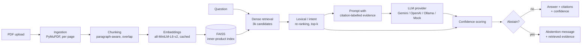

# TrustRAG: Trustworthy Retrieval-Augmented QA for Technical Documents

An end-to-end retrieval-augmented generation (RAG) system for question answering over PDF documents. Answers must cite the retrieved evidence, every answer receives a confidence estimate, and the system abstains when the evidence is weak.

[](https://github.com/mhrezvannia/trust-rag/actions/workflows/ci.yml)
[](https://www.python.org/)

## Problem and motivation

LLMs answering questions about technical documents (papers, specifications, manuals) often produce fluent answers that the source does not support. In engineering and research work, a plausible but wrong answer can cost more than no answer. TrustRAG explores three practical safeguards in a small, readable pipeline:

1. **Citation-grounded generation.** The model sees only retrieved passages, each labelled with a citation string, and must cite the passages it uses.
2. **Confidence estimation.** Every answer is scored with transparent heuristics over retrieval strength, evidence agreement and grounding signals.
3. **Abstention.** If the model or the confidence gate judges the evidence insufficient, the system returns a fixed "insufficient evidence" message instead of an answer.

This is a research-engineering artifact, not a finished research contribution. The confidence model is hand-tuned and uncalibrated, and the evaluation is qualitative (see [Limitations](#limitations-and-future-work)).

## Method and architecture



| Stage | Module | Details |
|---|---|---|
| Ingestion | `app/ingestion.py` | Extracts text page by page with PyMuPDF, normalises whitespace and skips empty pages. Page numbers stay 1-based so citations match the PDF. |
| Chunking | `app/chunking.py` | Splits each page into paragraphs (on blank lines) and packs them into chunks of at most 700 words. The last 120 words of a chunk are carried into the next chunk when they fit. Paragraphs longer than 700 words are split into overlapping windows. Chunks never span pages; IDs have the form `<document>-chunk-<n>`. |
| Embedding | `app/embeddings.py` | `sentence-transformers/all-MiniLM-L6-v2` with L2-normalised vectors. Embeddings are cached on disk, keyed by a SHA-256 hash of the model name, chunk IDs and chunk texts. |
| Index | `app/vectorstore.py` | Exact FAISS `IndexFlatIP`, so the inner product equals cosine similarity. Scores are mapped to [0, 1] with `s = (cos + 1) / 2`. |
| Retrieval | `app/retrieval.py` | Fetches `3k` candidates (default `k = 5`), re-ranks them and keeps the top `k` (formula below). |
| Generation | `app/prompts.py`, `app/llm.py` | Builds a JSON evidence list (citation string, score, text; at most 12,000 characters of evidence in total). Calls the configured provider at temperature 0 and parses its JSON reply. |
| Trust | `app/confidence.py`, `app/answering.py` | Scores confidence and decides whether to abstain (details below). |
| UI | `app/ui.py` | Streamlit app: upload and index PDFs, ask questions, inspect citations, retrieved chunks, confidence level, numeric score and the signals behind it. |

**Re-ranking.** For a candidate with dense score `s`:

```
s' = min(1, 0.72·s + 0.18·lexical + 0.10·intent + boost)
```

- `lexical` is the fraction of the query's content terms (more than 2 characters, not stopwords) that occur in the chunk.
- `intent` applies when the query mentions a term from one of five intent groups (future work, limitations, results, dataset, method). It is the fraction of those groups' terms that occur in the chunk.
- `boost` adds +0.12, +0.10 and +0.08 when "future work", "limitation" and "conclusion", respectively, appear in both the query and the chunk.

## Citation grounding, confidence and abstention

**Citation grounding.** Each evidence passage is shown to the model with a fixed citation string, `[Source: <document>, p. <page>, chunk <chunk_id>]`. The system prompt tells the model to:

- answer only from the evidence;
- never introduce unsupported facts or numbers;
- cite with the exact citation strings provided;
- prefer the highest-ranked directly relevant chunk;
- set `abstain: true` when the evidence is insufficient.

The reply must be JSON with the fields `answer`, `citations`, `reasoning_summary` and `abstain`. Code fences and surrounding prose are stripped before parsing. Unparseable output is reported as a provider error instead of being shown as an answer.

**Confidence signals** (`score_confidence`), computed over the re-ranked scores of the top 5 evidence chunks:

| Signal | Definition |
|---|---|
| `top`, `avg`, `top2` | Highest score, mean score, mean of the two highest scores |
| `gap` | `top` minus the second score (equal to `top` if only one chunk is retrieved) |
| `supported` | Number of chunks with score ≥ 0.30 |
| `strong` | Number of chunks with score ≥ 0.65 |
| `coverage` | Fraction of the answer's words (more than 3 characters, case-insensitive) that occur in the evidence |
| `numeric` | Fraction of the numbers in the answer, percentages included, that occur verbatim in the top chunk (0 if the answer has no numbers) |
| `sufficient` | `top ≥ 0.58` and `coverage ≥ 0.50` and (`numeric ≥ 0.80` or top chunk ≥ 300 characters) |
| `citation` | `min(1, unique citations / required)`, where `required = 1` if `sufficient`, else `max(supported, 1)` |

The numeric confidence score is the following weighted sum, clipped to [0, 1]:

```
score = 0.22·avg + 0.20·top + 0.15·top2 + 0.10·min(gap + 0.2, 1)
      + 0.10·min(supported/3, 1) + 0.10·min(strong/2, 1)
      + 0.07·citation + 0.08·coverage + 0.08·numeric
```

**Abstention.** The confidence gate abstains if any of these conditions holds:

- `top < 0.30`;
- `supported = 0`;
- `strong = 0`, `sufficient` is false, **and** at least one of `top2 < 0.62`, `coverage < 0.40` or `citation < 0.67` holds;
- `score < 0.45` and `coverage < 0.45`.

The final answer abstains if the model abstains **or** the gate does. In that case the answer text is replaced by a fixed message and the citations are removed. The retrieved evidence stays visible for inspection.

**Confidence levels.** The level is `High` if `score ≥ 0.72`, `Medium` if `score ≥ 0.45`, and `Low` otherwise or whenever the gate abstains. The UI lists every signal that fired as a human-readable reason.

## Provider-agnostic LLM layer

All providers implement one interface, `LLMProvider.answer(question, evidence, prompt) -> LLMAnswerDraft`. The provider is chosen by `LLM_PROVIDER` in `.env`:

| `LLM_PROVIDER` | Backend | Settings |
|---|---|---|
| `gemini` (default) | Google Gemini REST API (`generateContent`, JSON response mode) | `GEMINI_API_KEY`, `GEMINI_MODEL` (default `gemini-2.5-flash`) |
| `openai` | OpenAI Responses API via the official SDK | `OPENAI_API_KEY`, `OPENAI_MODEL` (default `gpt-4.1-mini`) |
| `ollama` | Local Ollama server (`/api/generate`, JSON format) | `OLLAMA_BASE_URL`, `OLLAMA_MODEL` (default `gemma3:4b`), `OLLAMA_NUM_CTX`, `OLLAMA_NUM_PREDICT` |
| `mock` | Deterministic, offline. Answers from the top chunk with one citation and abstains when the top score is below 0.30 | – |

If `gemini` or `openai` is selected without an API key, the app falls back to `mock`. The active provider is shown in the UI. Network, HTTP, timeout and parsing failures are raised as `LLMProviderError` and displayed in the UI instead of crashing it. The embedding model is set by `EMBEDDING_MODEL`. See [`.env.example`](.env.example) for all settings.

## Evaluation

`app/evaluation.py` provides `run_lightweight_evaluation(pdf_paths, examples)`. It indexes the given PDFs, runs the full pipeline for each `EvaluationExample(question, expected_keyword="")` and returns a pandas DataFrame with one row per question:

| Column | Meaning |
|---|---|
| `abstained` | Whether the final answer abstained |
| `confidence` | Confidence level (`High` / `Medium` / `Low`) |
| `top_score` | Re-ranked score of the best evidence chunk |
| `citation_count` | Number of citations in the final answer |
| `keyword_present` | Case-insensitive check that `expected_keyword` appears in the final answer (`None` if no keyword is given) |
| `answer` | Final answer text |

`notebooks/evaluation.ipynb` runs this on every PDF in `data/uploads/`, using three generic questions (`app/notebook_data.py`), and ends with a checklist for manual review: are the top-ranked chunks relevant, does the system abstain on weak evidence, and are the answer's claims grounded in the retrieved text? There are no gold answers, so it supports qualitative inspection rather than benchmark metrics.

```bash
pip install notebook           # Jupyter is not part of requirements.txt
cp /path/to/papers/*.pdf data/uploads/
jupyter notebook notebooks/evaluation.ipynb
```

The unit tests (`tests/`, pytest) cover chunking, vector search, re-ranking, prompt and citation construction, confidence and abstention, provider error handling, PDF ingestion, the evaluation loop and a headless run of the Streamlit app. They run fully offline, with a deterministic hashing embedder in place of the sentence-transformers model and stubbed or mock LLM providers.

## Results

This release reports **no quantitative QA results**. The repository contains no evaluation dataset, and the notebook is distributed without outputs. The following was reproduced offline for this release:

| Check | Command | Outcome |
|---|---|---|
| Unit and integration tests | `python -m pytest` | 62 passed (Python 3.10, 3.11, 3.12) |
| Lint | `ruff check .` | no findings |

## Quickstart

Requires Python 3.10–3.12.

```bash
git clone https://github.com/mhrezvannia/trust-rag.git
cd trust-rag
python -m venv .venv
source .venv/bin/activate          # Windows: .venv\Scripts\activate

# Optional: CPU-only PyTorch (much smaller download) before the other dependencies
pip install torch --index-url https://download.pytorch.org/whl/cpu
pip install -r requirements.txt

cp .env.example .env               # Windows: copy .env.example .env
# Edit .env: choose LLM_PROVIDER and add the matching API key,
# or set LLM_PROVIDER=mock to try the pipeline without any LLM.
```

Start the app with any of these commands:

```bash
streamlit run app/main.py          # any platform
python run_app.py                  # any platform, runs from the repository root
bash run_app.sh                    # Linux / macOS
```

Then upload one or more text-based PDFs, click **Parse and Index Documents** and ask a question. On first use, the embedding model (about 90 MB) is downloaded from Hugging Face. `.streamlit/config.toml` disables Streamlit's file watcher, which conflicts with `torch`.

To run the tests and the linter:

```bash
pip install -r requirements-dev.txt
python -m pytest
ruff check .
```

## Project structure

```text
trust-rag/
├── app/
│   ├── main.py              # Streamlit entry point
│   ├── ui.py                # Streamlit interface
│   ├── config.py            # Settings from .env (pydantic-settings)
│   ├── schemas.py           # Pydantic data models
│   ├── ingestion.py         # PDF text extraction (PyMuPDF)
│   ├── chunking.py          # Paragraph-aware chunking with overlap
│   ├── embeddings.py        # Sentence-transformers embeddings + disk cache
│   ├── vectorstore.py       # FAISS index
│   ├── retrieval.py         # Dense retrieval + lexical/intent re-ranking
│   ├── prompts.py           # System prompt and evidence formatting
│   ├── llm.py               # Gemini / OpenAI / Ollama / Mock providers
│   ├── answering.py         # Generation + abstention
│   ├── confidence.py        # Confidence scoring
│   ├── evaluation.py        # Lightweight evaluation loop
│   ├── notebook_data.py     # Default evaluation questions
│   └── sample_questions.py  # Sample questions shown in the UI
├── notebooks/evaluation.ipynb
├── tests/                   # Offline pytest suite
├── data/                    # Runtime uploads, caches, indexes (git-ignored)
├── .github/workflows/ci.yml # Ruff + pytest on Python 3.10–3.12
├── .env.example
├── pyproject.toml
├── requirements.txt / requirements-dev.txt
├── run_app.py / run_app.sh
├── CITATION.cff
└── CHANGELOG.md
```

## Limitations and future work

**Limitations**

- **Uncalibrated confidence.** The weights and thresholds are hand-set heuristics and have not been calibrated against human judgements or observed accuracy.
- **Lenient similarity scale.** Retrieval scores use `(cos + 1) / 2`, so a chunk with zero cosine similarity to the query already scores 0.5 before re-ranking. The 0.30 minimum is therefore lenient; the combined abstention conditions are the stricter checks.
- **Unverified citations.** Citations are counted, not checked: the confidence score uses the number of unique citation strings the model returns but does not verify that they match retrieved chunks.
- **Shallow grounding signals.** Lexical coverage is bag-of-words overlap and numeric grounding checks only the top chunk. Neither verifies entailment.
- **Domain-specific intent terms.** The re-ranking intent groups include domain-specific terms such as `nystrom` and `landmark`.
- **Text-based PDFs only.** There is no OCR, and table and figure content is extracted only as plain text.
- **No persistent index.** The index lives in the Streamlit session. `FaissVectorStore.save`/`load` exist but are not used by the UI.
- **Qualitative evaluation.** The evaluation has no gold answers, so retrieval and grounding quality are not measured quantitatively.

**Future work**

- Build a curated QA set (20–50 questions with gold answers and evidence pages) and report retrieval recall@k, answer correctness and citation precision.
- Measure selective-prediction quality (risk–coverage curves) and calibrate the confidence score, for example against human-judged support.
- Verify that cited passages match retrieved chunks and check entailment between the answer and the cited text.
- Run ablations of re-ranking, the confidence signals and the abstention rules, and add hybrid lexical-dense retrieval.
- Persist indexes across sessions and highlight cited spans in a page preview.

## Citation

If you use this software, please cite it as below. A machine-readable [`CITATION.cff`](CITATION.cff) is included, so GitHub also offers a "Cite this repository" button.

```bibtex
@software{rezvannia_trustrag_2026,
  author  = {Rezvannia, Mohammad Hossein},
  title   = {{TrustRAG}: Trustworthy Retrieval-Augmented {QA} for Technical Documents},
  year    = {2026},
  version = {1.0.0},
  url     = {https://github.com/mhrezvannia/trust-rag}
}
```

## Author

**Mohammad Hossein Rezvannia**: M.Sc. software-engineering researcher interested in AI-assisted software engineering and trustworthy LLM systems.
GitHub: [@mhrezvannia](https://github.com/mhrezvannia) · Email: mh.rezvannia@gmail.com

No license file has been added yet, so default copyright applies. Contact the author regarding reuse.
